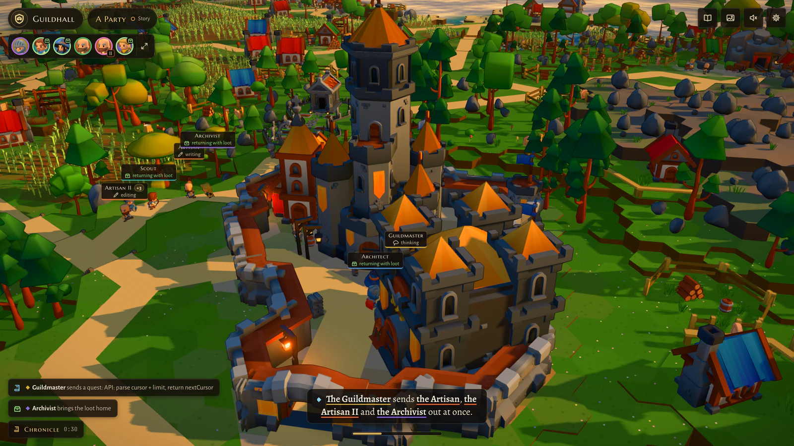
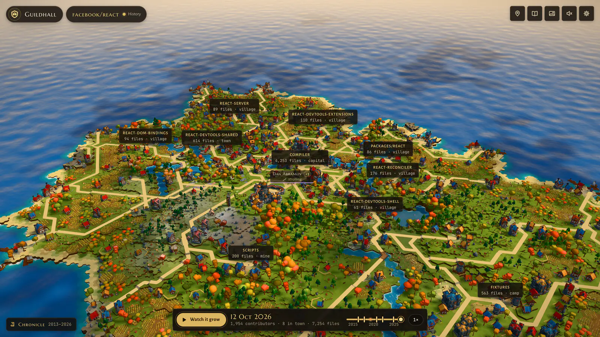
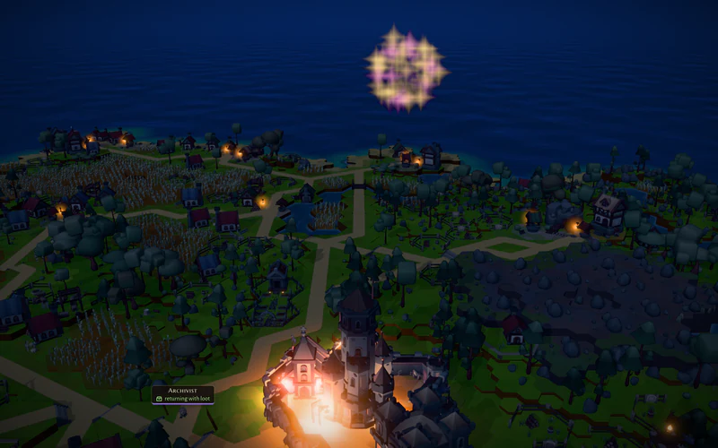
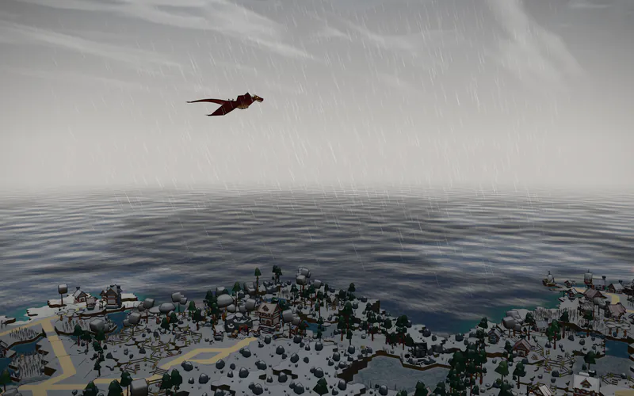
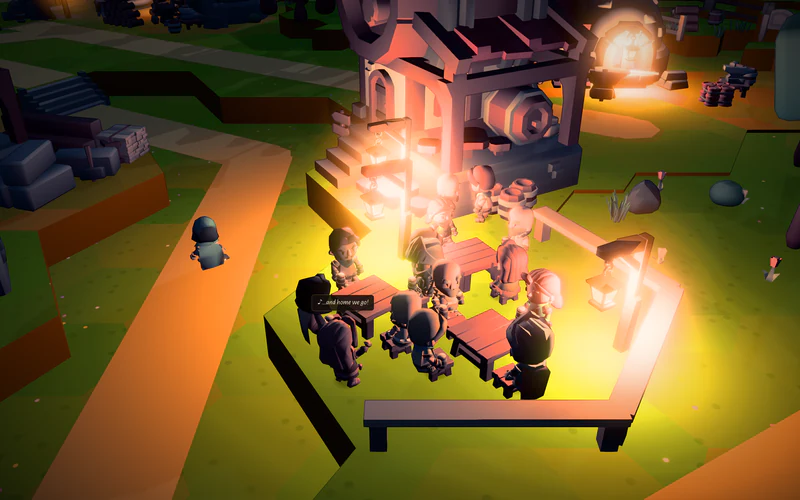
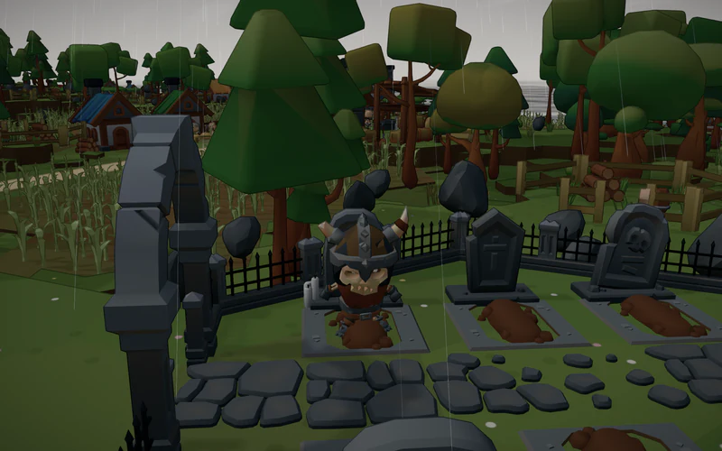
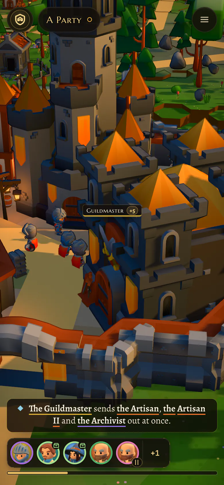
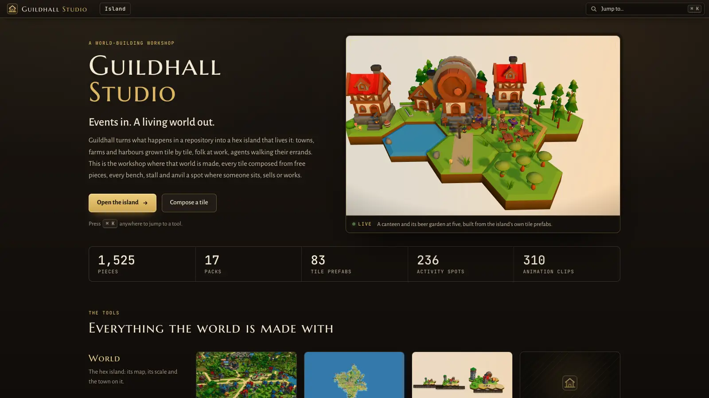

<h1 align="center">Guildhall</h1>

<p align="center">
  <strong>Events in. A living world out.</strong><br />
  A repository, its coding agents and its CI, grown into a hex island with people on it.
  In your browser, with nothing to install.
</p>

<p align="center">
  <a href="https://guildhall.codestz.dev"><strong>See it live</strong></a> ·
  <a href="https://guildhall.codestz.dev/demos">Demos</a> ·
  <a href="https://guildhall.codestz.dev/hall/facebook/react">React's island</a> ·
  <a href="https://guildhall.codestz.dev/built">How&nbsp;it's&nbsp;built</a> ·
  <a href="https://guildhall.codestz.dev/studio">Studio</a>
</p>

<p align="center">
  <a href="LICENSE"></a>
  
</p>

<p align="center">
  
</p>

Guildhall turns what happens in a repository into a world you can watch. The repo's folders and
packages become towns, villages, a mine and a harbour on a hex island, and the island grows with the
repo. Each coding agent is a hero who walks to the place its work touches. Pull requests sail in as
ships, CI is the weather, and townsfolk keep their own day around it all. When things go wrong, the
island answers: a storm, a skeleton in the graveyard, a dragon over the peaks. When they go well, there
are fireworks.

This is V2, a rebuild of [V1](#v1). Same idea, a new world: hex tiles, prefabs authored as data, a
castle that grows with the repo, and a world built off the main thread.

## What you can do

- **Watch a demo story.** [Demos](https://guildhall.codestz.dev/demos) plays guilds of agents at
  work: the five-act Saga, [World events](https://guildhall.codestz.dev/?story=events), a party, a
  lone hero, Claude Code and OpenCode side by side, a GitHub sea, a rush of twelve quests. Click a
  hero to follow it, and a director picks the shots when you don't.
- **Grow a public repo's island from its history.** `/hall/<owner>/<repo>` builds the island from
  the repo's chronicle, then **Watch it grow** replays it from the first commit.
  [The Harbour](https://guildhall.codestz.dev/harbour) lists every repo with a chronicle.
- **Connect Claude Code live, on your machine.** Your sessions show up as heroes on your repo's
  island while they work. This runs on localhost only ([how](#connect-claude-code-live)).
- **Take it on your phone.** The HUD folds into a face bar, a caption and one menu, and one finger
  orbits around the hero you follow.

<p align="center">
  
  <br /><sub>React's island at <a href="https://guildhall.codestz.dev/hall/facebook/react">/hall/facebook/react</a>.</sub>
</p>

## The island answers

Real events set off the island's own shows. Nothing is faked: each one is earned by a rule, and a
live hall spaces the big ones at least 150 seconds apart.
[World events](https://guildhall.codestz.dev/?story=events) is a four-minute demo that earns every
one in turn.

<table>
  <tr>
    <td width="25%"></td>
    <td width="25%"></td>
    <td width="25%"></td>
    <td width="25%"></td>
  </tr>
  <tr>
    <td valign="top"><sub><strong>Fireworks.</strong> Fifteen clean deeds earn a festival at nightfall.</sub></td>
    <td valign="top"><sub><strong>The dragon.</strong> Three failed builds in a row bring it over the peaks.</sub></td>
    <td valign="top"><sub><strong>The tavern.</strong> At 20:00 the tables drink, toast and sing.</sub></td>
    <td valign="top"><sub><strong>The graveyard.</strong> A red CI run raises a skeleton. A fix lays it to rest.</sub></td>
  </tr>
</table>

There is more: a comet for the hundredth deed, a rainbow when a storm clears, a ghost ship, pirates
when a party's bill runs high, a galleon for a release, a lighthouse for CI. At sea, wakes follow
every boat, and open issues queue on the quay as plates. In town, lamplighters go round at dusk and
a few of the latest drinkers walk home tipsy.

## The site

| Route | What it is |
|---|---|
| [`/`](https://guildhall.codestz.dev) | The island with a demo guild at work. Type an `owner/repo` to open its hall. |
| [`/demos`](https://guildhall.codestz.dev/demos) | The demo stories, opened over the island (`/?story=saga`, `events`, `party`, `solo`, `factions`, `seas`, `rush`) |
| [`/hall/<owner>/<repo>`](https://guildhall.codestz.dev/hall/facebook/react) | A repo's island, grown from its chronicle, with its history on a timeline |
| [`/harbour`](https://guildhall.codestz.dev/harbour) | Every chronicled repo |
| [`/built`](https://guildhall.codestz.dev/built) | How it's built: the engineering, the numbers, and the journey |
| [`/studio`](https://guildhall.codestz.dev/studio) | The Studio, the workshop the world is made in |

A **chronicle** is a public repo's whole history, read once and stored small: its folders over time,
its releases, its contributors week by week. No code and no file contents. Chronicles are built and
served by [guildhall-chronicles](https://github.com/Codestz/guildhall-chronicles); open a request there
to add a repo. A repo with no chronicle opens as a **sketch**: the generator's own island, marked as
such, not that repo's.

## Quick start

Needs [Bun](https://bun.sh) 1.3.5 or later.

```sh
bun install
bun run dev        # the site and the Studio, on http://localhost:5300
```

Open <http://localhost:5300>. The island, the demos and the halls all run from here.

The 3D models are not in the repo. They are free CC0 packs, imported into `library/` (gitignored)
once:

1. Download the free tiers of the packs listed under [Credits](#credits). Put the zips in
   `assets/raw/` and unzip each into `assets/src/<zip name>/`, e.g.
   `assets/src/KayKit_Medieval_Hexagon_Pack_1.0_FREE/`.
2. Run `bun run import` (or name packs: `bun run import kaykit-hexagon kenney-nature`). It
   normalises scale and pivots, maps colours onto one palette, bakes them into vertex colours and
   writes the catalog. `assets/DOWNLOADS.md` lists every source and licence.

Other scripts:

```sh
bun run check      # lint, typecheck and tests
bun test           # tests only
bun run shots <url> --out <path>   # a headless screenshot with frame stats
```

## Connect Claude Code live

Live mode is **localhost only**. The hub that collects your sessions binds `127.0.0.1` and refuses
any non-local origin, so the public site never sees your agents. It is V1's hub and hook, kept under
`legacy/` and unchanged.

1. Install V1's dependencies once:

   ```sh
   cd legacy && bun install && cd ..
   ```

2. Print the hook block and merge it into the settings of the project you want to watch
   (`<project>/.claude/settings.local.json`), or into `~/.claude/settings.json` for every project:

   ```sh
   bun legacy/packages/claude-code/src/install.ts --print
   ```

   The command only prints; it never edits a settings file. The hook runs on 13 Claude Code events,
   says nothing back to Claude and always lets it carry on. If Claude Code can't find `bun`, put
   the full path from `which bun` in the printed commands. To remove it, delete the block.

3. Start a Claude Code session in that project. The hook starts the hub the first time it's needed;
   you can also run it yourself with `bun legacy/packages/hub/src/main.ts` (port 4747).

4. With `bun run dev` running, open:

   ```
   http://localhost:5300/hall/<owner>/<repo>?feed=live
   ```

   The hub names each project after its folder, and the hall follows the guild named like
   `<repo>`. If the folder has another name, add `&guild=<folder name>`.

Each session is a hero, each subagent another. Heroes walk to the package of the file they touch;
the Guildmaster (the session that sends the others out) stays in the great hall. A permission
request shows as a plea over the hero. When the project's remote is on GitHub, the hub also watches
it: pull requests sail in as ships and CI sets the weather (`GUILDHALL_GITHUB=0` turns that off).

Chronicles of your sessions are kept in `~/.cache/guildhall/chronicles/<project>/`. They hold your
prompts and code, so treat them like your shell history. Nothing is uploaded.

## How it's built

The long read, with measured numbers, is [How it's built](https://guildhall.codestz.dev/built). In
short:

| Package | What it is |
|---|---|
| [`packages/core`](packages/core) | Types, the event vocabulary (V1's wire format), hashing, the logger |
| [`packages/assets`](packages/assets) | The catalog, the palette and the house style |
| [`packages/world`](packages/world) | The hex island: terrain, rivers, places, roads, sites, tiles to prefabs, collisions, life plans |
| [`packages/sim`](packages/sim) | Pure reducers over events: heroes, places, story, captions, legends, chronicles, the demo stories |
| [`packages/render`](packages/render) | three.js: the stage, batches and LOD, crowd, water, sky, shadows, event effects |
| [`packages/ui`](packages/ui) | The React HUD and site pieces |
| [`apps/studio`](apps/studio) | The site and the Studio in one app |
| [`tools/*`](tools) | `import` (packs to library), `shots` (screenshots and the perf bench), `palette`, `chronicle` (the deep chronicle builder the chronicles repo runs) |
| [`legacy/`](legacy) | V1, still runnable: the hub and the Claude Code hook live mode uses |

- **One-way layers.** `core → assets → world → sim → render`, each importing only the ones before
  it. `ui` sits beside render and never touches three.js. Apps may use any package but never import
  three directly. The pure layers (core to sim) import no three, React or Node, so they run in
  workers and tests. A test (`test/layers.test.ts`) enforces it.
- **The world is built in a worker.** Terrain, places, roads, tiles and life plans are generated
  off the main thread, behind a loading cover; the island shows once, whole.
- **Stable growth.** An island of N tiles is exactly the first N tiles of any bigger one, so a
  growing repo only adds land at the edge, and the history replay never moves what is there.
- **Event-sourced.** Every source becomes one log of events. The hall reads the world at a time `t`
  by replaying the log from the nearest checkpoint, so live, replay, scrubbing and stories are one path.
- **Data, not code, for the look.** Tile prefabs are JSON in `data/tiles/`, with the spots where
  people sit, work and talk, authored in the Studio.

## On your phone

<p align="center">
  
</p>

The same site works at 390 px wide. The top row is the crest, the repo and a menu. The menu opens
one bottom sheet (Guild, Places, Chronicle, Settings). At the bottom are the face bar, the caption
and a thin timeline. Chips show names only, except on the hero you follow. Landscape is laid out
like the desktop.

## The Studio

<p align="center">
  
</p>

The Studio is where the world is made: pieces and palette at true scale, the tile composer, the hex
map with its knobs, NPCs, grips (how every character holds every prop in every animation). It is
public at [/studio](https://guildhall.codestz.dev/studio). Online it is read-only: explore freely,
nothing is saved. On localhost, saving writes to `data/`.

## Performance

The bar is 60 fps on an M1 laptop at the default quality, and the rule is that **performance work
must not change what you see**.

- LOD switches only where the difference is under about a pixel, and crossfades over a band; every
  threshold has a gap between switching in and out, so nothing pops or flickers.
- The governor holds a 12 ms frame by trading resolution, a quarter step of pixel ratio at a time.
  It never overrides a quality you pick in Settings.
- Shadow cascades re-aim only when the camera leaves an inner area, so panning costs what standing
  still does.
- Placed pieces are batched per material, the crowd draws from one baked bone texture, and the
  island draws in a few dozen calls.
- A static draw list, one shared material per kind of object and no extra anti-aliasing pass keep
  a standing camera nearly free. The 3D models ship gzipped.

The hero view draws in 8.1 ms at the 95th percentile, and a first visit downloads 5.2 MB (it was
9.3). A 12,000-file island at mid and wide views still takes 12 to 15 ms a frame, GPU-bound, over the 12 ms the governor aims for. Numbers are measured
with the bench in `tools/shots` on a quiet machine, never estimated.

## Credits

All 3D assets and sounds are CC0 1.0. Attribution isn't required; it is given anyway.

- **3D models and animations** by **Kay Lousberg**, [KayKit](https://kaylousberg.itch.io/), under
  [CC0 1.0](https://creativecommons.org/publicdomain/zero/1.0/). Free tiers of Medieval Hexagon Pack,
  Forest Nature Pack, Medieval Builder Pack, Resource Bits, RPG Tools Bits, Furniture Bits,
  Adventurers 2.0, Fantasy Weapons Bits, Skeletons 1.1, Dungeon Pack 1.1, Halloween Bits and Character
  Animations 1.1.
- **3D models** by **Kenney**, [kenney.nl](https://kenney.nl/), under
  [CC0 1.0](https://creativecommons.org/publicdomain/zero/1.0/): Nature Kit, Castle Kit, Fantasy Town
  Kit 2.0, Graveyard Kit, Survival Kit and Pirate Kit.
- **Sound effects** by **Kenney**, under [CC0 1.0](https://creativecommons.org/publicdomain/zero/1.0/):
  a few samples from [RPG Audio](https://kenney.nl/assets/rpg-audio) and
  [Impact Sounds](https://kenney.nl/assets/impact-sounds). Sound is off until you turn it on.
- Built with [three.js](https://threejs.org), [React](https://react.dev), [Vite](https://vite.dev)
  and [Bun](https://bun.sh). Fonts from Google Fonts.

The full list of sources, with links and licence files, is in `assets/DOWNLOADS.md`. Other packs
were imported while exploring (Quaternius among them), but they are not in the house style and the
site does not ship them.

## V1

V1 is kept for history. Its code is on the [`v1` tag](https://github.com/Codestz/guildhall/tree/v1)
(the hub and the Claude Code hook that live mode uses are kept here). V1 had the OpenCode plugin (`opencode-guildhall` on npm), the
archipelago of repos and the WebGPU renderer; [RELEASE_NOTES.md](RELEASE_NOTES.md) says what moved,
what changed and what is parked. Animals are parked too: they did not fit the low-poly style, so
pens and pastures stand empty for now.

## License

[MIT](LICENSE) © 2026 Codestz. The bundled assets are CC0, as credited above.
